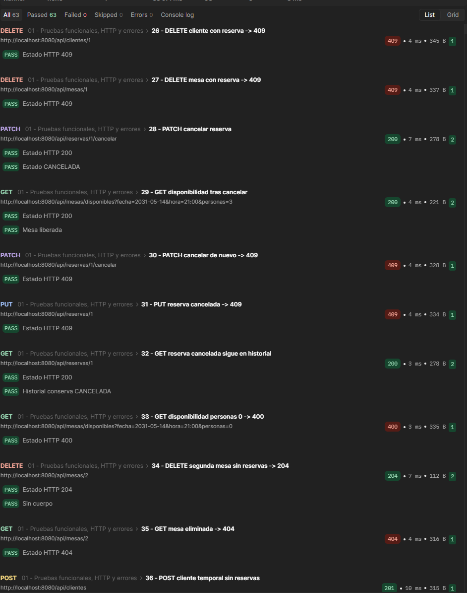
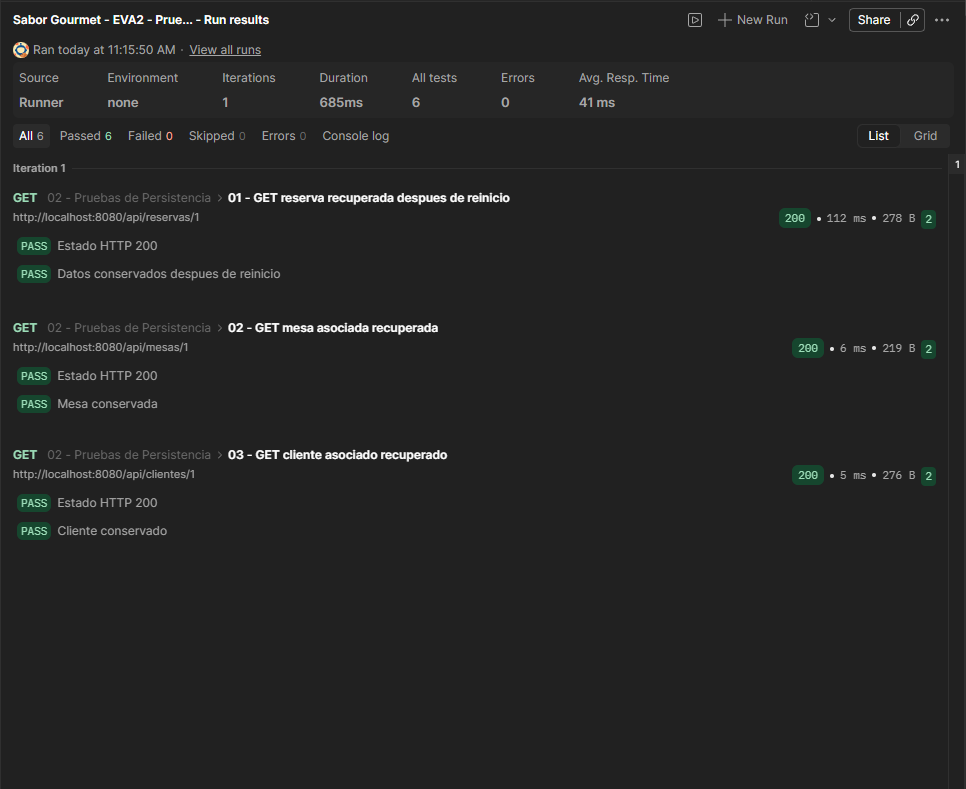

# Evidencias de pruebas — Sabor Gourmet

Las siguientes ejecuciones fueron realizadas en Windows el **22 de noviembre de 2026**. Se utilizaron Java 21, Spring Boot 4.2.0, Maven Wrapper y Postman.

## 1. Pruebas automatizadas

Comando:

```powershell
.\mvnw.cmd clean test
```

Resultado comunicado por la consola de Maven:

```text
Tests run: 41, Failures: 0, Errors: 0, Skipped: 0
BUILD SUCCESS
```

Las 41 pruebas se distribuyen entre el arranque de Spring Boot (1), repositorio JSON (4), Service de clientes (6), Service de mesas (7) y Service de reservas (23).

## 2. Funcionalidad y respuestas HTTP en Postman

- Carpeta: `01 - Pruebas funcionales, HTTP y errores`
- Solicitudes ejecutadas: **39**
- Aserciones aprobadas: **63**
- Fallidas: **0**
- Errores: **0**



Casos relevantes: creación y modificación de cliente y mesa; consulta de disponibilidad; creación de reserva; rechazo de solapamiento y sobrecapacidad (409); validación de datos (400); identificador inexistente (404); cancelación mediante `PATCH /api/reservas/{id}/cancelar` (200); historial conservado y disponibilidad liberada; eliminación de registros sin reservas (204).

## 3. Persistencia después de reiniciar

Secuencia: detener Spring Boot con `Ctrl+C`, conservar `datos.json`, reiniciar la API y ejecutar la carpeta `02 - Persistencia`.

- Solicitudes ejecutadas: **3**
- Aserciones aprobadas: **6**
- Fallidas: **0**
- Errores: **0**



Verificaciones: `GET /api/reservas/{id}` conserva la reserva; `GET /api/mesas/{id}` conserva su mesa; `GET /api/clientes/{id}` conserva su cliente. La reserva cancelada se mantiene en el historial en `datos.json`.

## 4. Evidencia del archivo JSON

La entrega incluye `datos.json` en la raíz de `sabor-gourmet-api`, con las tres colecciones y referencias entre registros. La ruta se configura mediante `app.datos.ruta=datos.json`.
